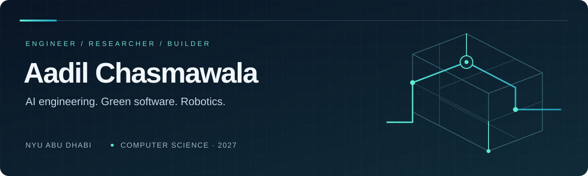
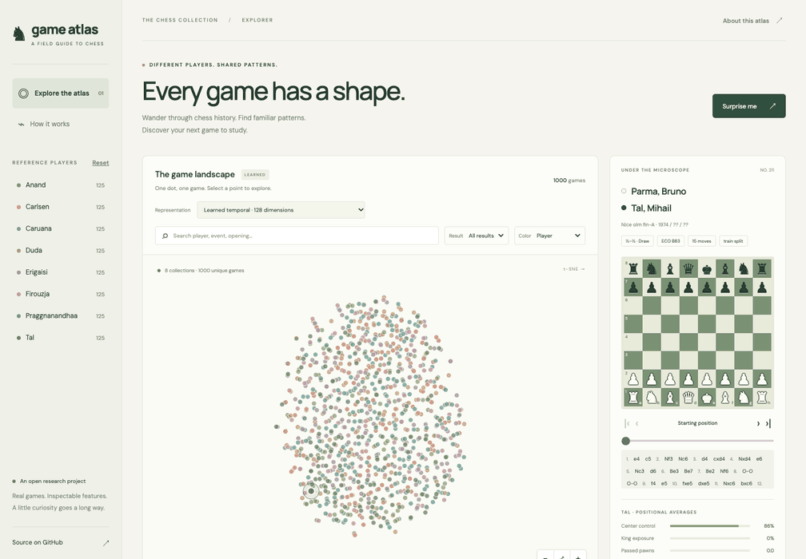
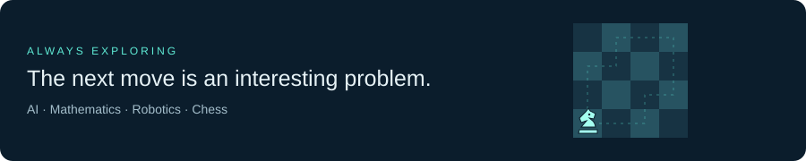

  

  <a href="https://aarz1401.github.io/Aadil-website/"><b>Portfolio</b></a> &nbsp; / &nbsp;
  <a href="https://www.linkedin.com/in/aadil-chasmawala/"><b>LinkedIn</b></a> &nbsp; / &nbsp;
  <a href="mailto:aac10066@nyu.edu"><b>Email</b></a>

# Hi, I'm Aadil.

I build AI tools that connect models to real workflows, and study the energy cost of the software they produce. My work spans enterprise agents, empirical research, and robots that interact with people.

I'm studying **Computer Science at NYU Abu Dhabi**, with minors in **Applied Mathematics and Economics** (Class of 2027). I care about systems that work, experiments that can be reproduced, and tools that other people can confidently use.

## 01 / AI engineering

**UNDP · AltFinLab** 
*Digital, AI & Innovation Intern · Sep 2026–present*

Building reproducible AI tools and automations for handover to non-technical staff, with a focus on practical workflows and usable documentation.

**Inception (G42)** 
*Data Engineer Intern · Jun–Aug 2026*

- Developed **15+ Model Context Protocol (MCP) tools** over Microsoft Graph APIs, connecting LLM agents to Outlook, Teams, SharePoint, and Planner.
- Built and tested **8 agentic workflows** for tasks including meeting preparation, email triage, and task prioritization; built Copilot Studio agents for sprint planning and HR scheduling.
- Evaluated Arize Phoenix, RAGAS, and DeepEval, and contributed to an observability pipeline using OpenTelemetry, Grafana Alloy, PostgreSQL, and Kubernetes.

## 02 / Research

**Green AI · NYU Abu Dhabi** 
*Research collaborator with Prof. João Paulo Fernandes · Dec 2024–May 2026*

Studied the energy consumption and performance of LLM-generated programs, comparing implementations across Python, C++, and Java. My public work includes measurement pipelines, analysis notebooks, and experiments in Python-to-C++ transpilation.

Co-author of **[Greening AI-enabled Systems with Software Engineering: A Research Agenda for Environmentally Sustainable AI Practices](https://arxiv.org/abs/2506.01774)** (2025).

I also explore representation learning through **[Game Atlas](https://github.com/Aarz1401/Chess-ML-Project)**: an interactive view of chess games with reproducible experiments and published evaluation limits.

## 03 / Robotics

**REACH Lab · NYU Abu Dhabi** 
*Student Research Assistant, Robotics · Sep 2026–present*

Working on the LLM and system-integration track of a robotics project with KINESIS and AD Ports, supporting competition operations and developing familiarity with the robot stack and ROS.

**[Mr. Octopus](https://github.com/Aarz1401/Mr-Octopus---A-Robot-with-emotions)** brings that interest in interaction into a physical build: a mobile robot with touch- and light-responsive emotional states, bidirectional XBee communication, Arduino control, and a p5.js audiovisual interface.

## 04 / Selected public projects

<table>
<tr>
<td width="50%" valign="top">

<h3><a href="https://github.com/Aarz1401/EnergyEfficiencyLLMCode">LLM Code Energy Benchmarking</a></h3>

Compare human-written and LLM-generated programs across Python, C++, and Java. Includes measurement scripts, analysis notebooks, and per-problem energy and performance visualizations.

Python · C++ · Java · perf · powermetrics

</td>
<td width="50%" valign="top">

<h3><a href="https://github.com/Aarz1401/Aarz_GreenTranspilation">Green Transpilation</a></h3>

An end-to-end workflow for Python-to-C++ translation, solution verification, checksum comparison, and energy benchmarking on LeetCode hard problems.

Python · C++ · LLMs · pyRAPL

</td>
</tr>
<tr>
<td width="50%" valign="top">

<h3><a href="https://github.com/Aarz1401/Chess-ML-Project">Game Atlas</a></h3>

Explore 1,000 chess games through five representations, move replay, and feature overlays. Reproducible experiments compare engineered, pretrained, and learned game fingerprints.

Representation learning · Chess · Interactive visualization

</td>
<td width="50%" valign="top">

<h3><a href="https://github.com/Aarz1401/Mr-Octopus---A-Robot-with-emotions">Mr. Octopus</a></h3>

A sensor-driven mobile robot that responds to touch and light through movement, sound, and visuals. Documents the hardware build, wireless communication, and user testing.

Arduino · XBee · p5.js · Physical computing

</td>
</tr>
</table>

<b>Watch Game Atlas in action — select games, compare representations, replay moves</b>

A recording of the actual Game Atlas interface, running locally from the public repository.

<a href="assets/game-atlas-still.png">View a still image</a> · <a href="https://github.com/Aarz1401/Chess-ML-Project">Explore the source and run it locally</a>

## 05 / Technical stack

| Area | Tools & technologies |
| :--- | :--- |
| **Languages** | Python, C++, C, Java, JavaScript, TypeScript, SQL |
| **AI & agents** | MCP, Microsoft Graph, LangChain, Copilot Studio, n8n |
| **ML & analysis** | PyTorch, TensorFlow, pandas, NumPy, Matplotlib |
| **Web & data** | React, Node.js, Express, PostgreSQL, MongoDB |
| **Systems & evaluation** | Docker, Linux, Git, OpenTelemetry; experience with Kubernetes, Arize Phoenix, RAGAS, DeepEval |
| **Physical computing** | Arduino, XBee, p5.js; learning ROS |

**Let's build something useful.** I'm interested in AI engineering, sustainable software, and robotics collaborations. 
[Get in touch](mailto:aac10066@nyu.edu) · [Explore my portfolio](https://aarz1401.github.io/Aadil-website/) · [Browse all repositories](https://github.com/Aarz1401?tab=repositories)

